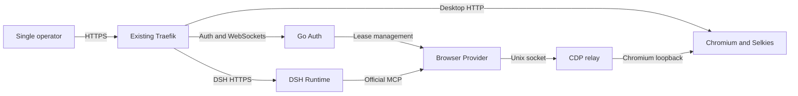

# Architecture — DSH Web Workstation

English · [简体中文](ARCHITECTURE.zh-CN.md)

## Product boundary

DSH Workstation is a self-hosted deployment, security, browser-control, and operations layer around the official DSH application. DSH remains the Agent runtime, chat/session UI, terminal, Profile, and Plugin Manager. This project does not own a competing Agent runtime, editor, package manager, or public plugin marketplace.

The first release is single-user: one local administrator, one DSH_HOME, one workspace, one Chromium profile. Multiple Passkeys may be registered to that administrator. No second account may share these resources. Multi-user support requires a separate tenant-isolation design and is out of scope.

## Component boundaries

| Component | Responsibility |
| --- | --- |
| Runtime image | Provides Node.js, pinned pnpm, Git/SSH, CA certificates, and common native build tools. DSH npm installations live in persistent storage and are managed by a dedicated CLI/API. |
| Runtime manager | Locks mutations, installs each exact release in its own directory, validates it, switches the current pointer atomically, checks startup, and rolls back on failure. Data migrations require a matched backup/restore path. |
| DSH Profile | Managed by the official CLI and Plugin Manager. Use the pinned release's directory structure and one DSH_HOME filesystem so pnpm links can reach the store. |
| Go Auth | Handles the single administrator's password, TOTP and WebAuthn, recovery codes, sessions, CSRF, rate limits, audit, and ForwardAuth. Stores state in SQLite WAL. Runtime runs the Agent. |
| Browser Provider | Receives official MCP calls, validates the session-bound lease and generation for every operation, and attaches to Chromium over CDP. Only explicitly approved tools are exposed. |
| Chromium and Selkies | One Chromium process and one persistent profile. Selkies handles human interaction, and the Provider automates the same browser. |
| Traefik | Routes the public HTTPS origin and delegates DSH and Selkies authentication to Go Auth. |
| Native Sidebar | Deferred enhancement. The authenticated standalone browser/control page is the supported first-release entry point. |

## Public Compose networks

| Network | Endpoints |
| --- | --- |
| Existing proxy | Traefik and Auth. Auth binds its public and verify listeners here and verifies the expected Traefik peer. |
| `workstation` | Runtime, the MCP listener, and the Traefik and Auth connections to DSH. |
| `browser` | Chromium, the Provider management listener, and the Traefik and Auth connections to Selkies. |

The relay shares Chromium's network namespace. Only the relay and Provider mount the CDP socket volume. Auth forwards DSH and Selkies WebSockets and checks the live session. [Tested topology](roadmap/public-compose.md)

Both subnets are configuration, not constants. `deploy/network.sh` derives the subnet definitions, dynamic `ip_range`, every static address, the Provider health-check destination, and the Runtime certificate SAN from `WORKSTATION_SUBNET` and `BROWSER_SUBNET`. Static addresses sit at `.2`/`.3` while dynamic allocation is confined to the upper half of each subnet, so a container that starts first cannot take a static address — the failure this ordering prevents is Docker answering "Address already in use" when the Runtime claims its own address.

`deploy/network.sh check` runs before the initializer creates anything and refuses on an overlap with a host route or an existing Docker network. It creates and modifies nothing. The default route is excluded by design: it covers every address and Docker's more specific subnet route wins. A state directory whose recorded subnets differ from the requested ones is refused rather than silently reissuing the internal CA, because the Runtime certificate is issued for the derived address; `--reissue` is the deliberate path.

## Routes

| Path | Upstream and access |
| --- | --- |
| `/` | DSH, protected by ForwardAuth. |
| `/browser/` | Selkies, protected by the same ForwardAuth. Traefik preserves the prefix. |
| `/_auth/` | Login and account UI/API. These routes are exempt from their own ForwardAuth. |
| Internal verification endpoint | Go Auth, which trusts only the configured Traefik peer. |
| Provider management | Private browser network only; never a public unauthenticated route. |

Verify subpath support, response headers, CSP, WebSockets, and sign-in behavior against the exact upstream versions.

## Data ownership and persistence

| Store | Contents |
| --- | --- |
| DSH_HOME | Runtime versions, Profile manifests and lockfiles, node_modules, pnpm store, sessions, settings, credentials, and plugin configuration. One persistent volume. |
| Workspace | Project files in a separate volume or bind mount. |
| Chromium `/config` | Persistent profile, cookies, extensions, and downloads. |
| Auth data | Single administrator and session state in SQLite, stored in a separate volume. |
| Provider state | Lease/recovery state required to fail closed across Provider restarts. |
| Auth secrets | Docker secrets or read-only files. Store and back them up separately from the database. |
| Deployment configuration | Git, with secrets kept outside the repository. |

## Authentication and account model

1. Bootstrap creates exactly one local administrator. Successful bootstrap permanently closes account creation.
2. Password login uses a separate TOTP challenge. Passkey is a separate login method; multiple Passkeys may be registered to the same administrator.
3. No user creation, invitation, role hierarchy, tenant selection, or shared-account mode is included.
4. The session cookie is `__Host-dsh_session` with `Secure`, `HttpOnly`, `SameSite=Lax`, and `Path=/`. Omit `Domain`.

## Browser control and security

- The control states are HUMAN, AGENT, HANDOVER, PAUSED, and DISCONNECTED.
- A lease records the lease ID, owner type and ID, DSH session ID, generation, and issue and expiry times. Use transactional compare-and-swap.
- Validate every tool call at one shared server-side admission point. Check the authenticated MCP peer, live DSH session binding, lease owner, generation, expiry, origin policy, and in-flight operation state.
- Block human keyboard and mouse input at the Selkies boundary during Agent control. Takeover must drain or safely cancel the active operation, release held input, confirm release, and only then change owner.
- Expiry, uncertain renderer completion, Provider restart, or browser process death must fail closed. Claim exclusive control only after testing the actual input path.
- Attach over CDP to the existing default Chromium context to share tabs and cookies. Prevent tools from closing the browser or context.
- `BROWSER_TOOL_ORIGINS` is a Provider application-layer origin allowlist. It is not an egress firewall or complete SSRF defense. Chromium still executes page scripts and follows redirects.
- Before broad Agent browsing of untrusted sites, add an independent browser egress control that blocks loopback, link-local, private, metadata, and other prohibited destinations after DNS resolution and on redirects. Keep CDP and Provider management private.

## Runtime upgrades and recovery

- Install candidate DSH releases side-by-side and never mutate the active installation in place.
- Before Profile or plugin dependency changes, create a DSH_HOME backup and record the exact Runtime, DSH, Profile, and plugin versions.
- Validate candidate startup, Node compatibility, Profile/Bundle compatibility, lockfile consistency, and explicitly approved lifecycle scripts.
- `dsh-runtime upgrade` is one transaction: install beside the active version, gate, probe a copy, fingerprint, archive plus manifest, then move the pointer. A blocked candidate stays installed and the pointer does not move.
- Approvals are for exact `package@version` and persist in DSH_HOME, so they also apply to a later rollback. Lifecycle scripts in the DSH release's own tree are reported, not blocking, because that policy is fixed at `--ignore-scripts` and identical for every version.
- A pointer rollback restores only the selected executable. If data migration occurred, restore the matching DSH_HOME backup and any coupled workspace state. `verify` compares Profile manifests, lockfiles and pnpm-store package versions against the pre-switch fingerprint and names the required action.
- A DSH_HOME backup excludes `runtime` and `pnpm` because both are reinstallable; it records the selection and Runtime image in a manifest instead, and refuses a restore whose checksum, ownership or DSH version does not match.
- Backups cover DSH_HOME, workspace, Chromium profile, Auth DB, Provider state, and encryption secrets. Restore tests must prove the administrator can still use TOTP and existing Passkeys.

## Releases and deployment

- Version Runtime, DSH npm, Auth, Provider, Workstation plugin (when shipped), and Chromium independently.
- CI must test the deployed Traefik compatibility range, including the actual target patch version; a passing newer CI version does not establish compatibility with an older deployment.
- Publish project-owned Runtime, Auth, and Provider images to GHCR using immutable version tags and digests. Keep reproducible build evidence and checksums.
- Initial support is Linux amd64. Do not claim ARM64 support until images and full-stack tests cover it.
- Keep the Docker socket out of DSH and Auth. Use least privilege, read-only filesystems where practical, non-root users, health checks, and explicit secret handling.

## Deferred work

The native DSH Sidebar is not a first-release gate. Keep the authenticated standalone browser/control page fully supported. Implement the Sidebar later through public DSH APIs only; do not fork DSH core or rely on private DOM internals.

Multi-user tenancy, Kubernetes, Windows Companion, a custom Agent runtime/editor, public plugin marketplace, and multiple simultaneous browser instances remain out of scope.
