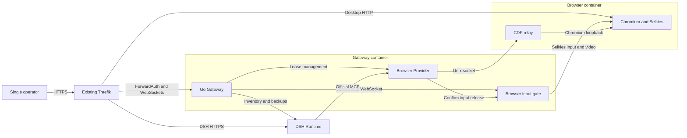

# Architecture — DSH Web Workstation

English · [简体中文](ARCHITECTURE.zh-CN.md)

## Product boundary

DSH Workstation is a self-hosted deployment, security, browser-control, and operations layer around the official DSH application. DSH remains the Agent runtime, chat/session UI, terminal, Profile, and Plugin Manager. This project does not own a competing Agent runtime, editor, package manager, or public plugin marketplace.

The first release is single-user: one local administrator, one DSH_HOME, one workspace, one Chromium profile. Multiple Passkeys may be registered to that administrator. No second account may share these resources. Multi-user support requires a separate tenant-isolation design and is out of scope.

## Component boundaries

| Component | Responsibility |
| --- | --- |
| Runtime image | Provides Node.js, pinned pnpm, Git/SSH, CA certificates, and common native build tools. DSH npm installations live in persistent storage and are managed by a dedicated CLI/API. |
| Runtime manager | Locks mutations, installs each exact release in its own directory, validates it, switches the current pointer atomically, checks startup, and rolls back on failure. Data migrations require a matched backup/restore path. |
| DSH Profile | Managed by the official CLI and Plugin Manager. Use the pinned release's directory structure and one DSH_HOME filesystem so pnpm links can reach the store. |
| Go Gateway | Hosts authentication, browser controls and the operations console. Stores administrator state in SQLite WAL. Calls Runtime for backups and archive checks. Its container also runs the Provider and input gate. |
| Browser Provider | Receives official MCP calls, validates the session-bound lease and generation for every operation, and attaches to Chromium over CDP. Only explicitly approved tools are exposed. |
| Chromium and Selkies | One Chromium process and one persistent profile. Selkies handles human interaction, and the Provider automates the same browser. |
| Browser input gate | Proxies the Selkies data WebSocket and confirms held input is released before Provider changes control. |
| Traefik | Routes the public HTTPS origin and delegates DSH and Selkies authentication to Go Gateway. |
| Native Sidebar | Deferred enhancement. The authenticated standalone browser/control page is the supported first-release entry point. |

## Public Compose networks

Core runs `gateway` and `runtime`. Full adds `browser`. Both reuse Traefik from outside the Workstation Compose project. [Service inventory](../deploy/public/README.md#choose-a-deployment-shape) · [ADR-0007](adr/0007-three-service-deployment.md)

| Network | Endpoints |
| --- | --- |
| Existing proxy | Traefik and Gateway. Gateway binds its public and verify listeners here and verifies the expected Traefik peer. |
| `workstation` | Runtime, Gateway and Browser. Traefik also joins this network to reach DSH and Selkies HTTP. |

Browser's Nginx checks the Gateway source address for the Selkies data WebSocket and token administration. Gateway routes the data WebSocket through its input gate after checking the operator's session. Provider control and the input gate listen on Gateway loopback. Browser binds Chromium's CDP TCP listener to loopback and writes a private Unix socket that Gateway mounts read-only. [Topology and CI](roadmap/public-compose.md)

`deploy/network.sh` derives static Runtime and MCP addresses at offsets `.2` and `.3`, the Runtime certificate SAN, and the upper-half dynamic pool from `WORKSTATION_SUBNET`. Browser uses a dynamic address.

`deploy/network.sh check` runs before initialization and refuses an overlap with a host route or an existing Docker network. The check compares specific routes because Docker's subnet route takes precedence over the default route. Changing the saved `WORKSTATION_SUBNET` requires `--reissue` to replace the Runtime certificate and internal CA.

## Routes

| Path | Upstream and access |
| --- | --- |
| `/` | DSH, protected by ForwardAuth. |
| `/browser/` | Selkies, protected by the same ForwardAuth. Traefik preserves the prefix. |
| `/_auth/` | Login and account UI/API. These routes are exempt from their own ForwardAuth. |
| `/mgmt` | Gateway console for the authenticated administrator. Runtime inventory, backup and archive checks, browser control, and account settings. |
| Internal verification endpoint | Go Gateway, which trusts only the configured Traefik peer. |
| Provider management | Gateway loopback with the internal administrator credential. |

Verify subpath support, response headers, CSP, WebSockets, and sign-in behavior against the exact upstream versions.

## Data ownership and persistence

| Store | Contents |
| --- | --- |
| DSH_HOME | Runtime versions, Profile manifests and lockfiles, node_modules, pnpm store, sessions, settings, credentials, plugin configuration, and user and shared skills. One persistent volume. |
| Workspace | Default Web workspace, project files, and project skills in a separate volume or bind mount. |
| Chromium `/config` | Persistent profile, cookies, extensions, and downloads. |
| Gateway SQLite (`auth-data`) | Single administrator and session state in SQLite, stored in a separate volume. |
| Provider state | Lease/recovery state required to fail closed across Provider restarts. |
| Authentication secrets | Docker secrets or read-only files. Store and back them up separately from the database. |
| Deployment configuration | Git, with secrets kept outside the repository. |

The Runtime image points Linux Documents to `/workspace`. DSH creates `/workspace/deepseek-harness/default-workspace` on first use and reuses an existing registration. Skills can live in `$DSH_HOME/skills`, `$DSH_AGENTS_HOME/skills` (backed by `$DSH_HOME/.agents` and reachable through `~/.agents`), or the project's `.agents/skills` directory.

## Authentication and account model

1. Bootstrap creates exactly one local administrator. Successful bootstrap permanently closes account creation.
2. Password login uses a separate TOTP challenge. Passkey is a separate login method; multiple Passkeys may be registered to the same administrator.
3. No user creation, invitation, role hierarchy, tenant selection, or shared-account mode is included.
4. The session cookie is `__Host-dsh_session` with `Secure`, `HttpOnly`, `SameSite=Lax`, and `Path=/`. Omit `Domain`.

## Browser control and security

- The control states are HUMAN, AGENT, HANDOVER, PAUSED, and DISCONNECTED.
- A lease records the lease ID, owner type and ID, DSH session ID, generation, and issue and expiry times. Use transactional compare-and-swap.
- Validate every tool call at one shared server-side admission point. Check the authenticated MCP peer, live DSH session binding, lease owner, generation, expiry, origin policy, and in-flight operation state.
- Block human keyboard and mouse input at the Selkies boundary during Agent control. Takeover must drain or safely cancel the active operation, release held input, confirm release, and only then change owner.
- Expiry, uncertain renderer completion, Provider restart, or browser process death must fail closed. Claim exclusive control only after testing the actual input path.
- Attach over CDP to the existing default Chromium context to share tabs and cookies. Prevent tools from closing the browser or context.
- `BROWSER_TOOL_ORIGINS` is a Provider application-layer origin allowlist, and the Agent may browse any HTTPS origin. This single-operator deployment does not require an SSRF or egress policy (ADR-0006). Keep CDP and Provider management private.

## Runtime upgrades and recovery

- Install candidate DSH releases side-by-side and never mutate the active installation in place.
- Before Profile or plugin dependency changes, create a DSH_HOME backup and record the exact Runtime, DSH, Profile, and plugin versions.
- Validate candidate startup, Node compatibility, Profile/Bundle compatibility, lockfile consistency, and explicitly approved lifecycle scripts.
- `dsh-runtime upgrade` is one transaction: install beside the active version, gate, probe a copy, fingerprint, archive plus manifest, then move the pointer. A blocked candidate stays installed and the pointer does not move.
- The Runtime supervisor holds the serving lock in the shared DSH_HOME. An independent maintenance container needs that lock for an upgrade, switch, rollback or restore. For Web upgrades, the supervisor stops DSH Web and passes the lock descriptor to its own CLI child. Backup uses a separate shared state lock and can run while DSH Web is up.
- `/mgmt/upgrade` validates an exact DSH version and recent TOTP before Gateway forwards the request to the private Runtime maintenance listener. The CLI and supervisor record phases atomically in `$DSH_HOME/runtime/upgrade-status.json` for Gateway to display. The supervisor starts the selected DSH Web process and checks readiness before Profile verification. Startup failure after a switch triggers matched-state restore. Independent CLI operations show their progress through the same volume.
- Approvals are for exact `package@version` and persist in DSH_HOME, so they also apply to a later rollback. Lifecycle scripts in the DSH release's own tree are reported, not blocking, because that policy is fixed at `--ignore-scripts` and identical for every version.
- A pointer rollback restores only the selected executable. If data migration occurred, restore the matching DSH_HOME backup and any coupled workspace state. `verify` compares Profile manifests, lockfiles and pnpm-store package versions against the pre-switch fingerprint and names the required action.
- A DSH_HOME backup excludes `runtime` and `pnpm` because both are reinstallable; it records the selection and Runtime image in a manifest instead, and refuses a restore whose checksum, ownership or DSH version does not match.
- Backups cover DSH_HOME, workspace, Chromium profile, Gateway SQLite database, Provider state, and encryption secrets. Restore tests must prove the administrator can still use TOTP and existing Passkeys.

## Releases and deployment

- Version Runtime, DSH npm, Gateway, Workstation plugin (when shipped), and Chromium independently.
- CI must test the deployed Traefik compatibility range, including the actual target patch version; a passing newer CI version does not establish compatibility with an older deployment.
- Publish Runtime and Gateway to GHCR using immutable version tags and digests. Provider and the input gate ship in Gateway. Keep reproducible build evidence and checksums.
- Initial support is Linux amd64. Do not claim ARM64 support until images and full-stack tests cover it.
- Keep the Docker socket out of DSH and Gateway. Use least privilege, read-only filesystems where practical, non-root users, health checks, and explicit secret handling.

## Deferred work

The native DSH Sidebar is not a first-release gate. Keep the authenticated standalone browser/control page fully supported. Implement the Sidebar later through public DSH APIs only; do not fork DSH core or rely on private DOM internals.

Multi-user tenancy, Kubernetes, Windows Companion, a custom Agent runtime/editor, public plugin marketplace, and multiple simultaneous browser instances remain out of scope.
