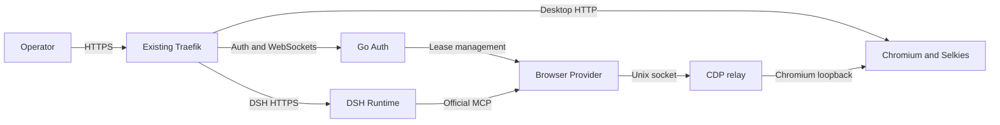

# Architecture — DSH Web Workstation

English · [简体中文](ARCHITECTURE.zh-CN.md)

## Component boundaries

| Component | Responsibility |
| --- | --- |
| Runtime image | Provides Node.js, pinned pnpm, Git/SSH, CA certificates, and common native build tools. DSH npm installations live in persistent storage and are managed by a dedicated CLI/API. |
| Runtime manager | Locks mutations, installs each exact release in its own directory, validates it, switches the current pointer atomically, checks startup, and rolls back on failure. The active installation stays intact. |
| DSH Profile | Managed by the official CLI and Plugin Manager. Use the pinned release's directory structure and one DSH_HOME filesystem so pnpm links can reach the store. |
| Go Auth | Handles password, TOTP and WebAuthn, recovery codes, sessions, CSRF, rate limits, audit, ForwardAuth, and browser lease coordination. Stores state in SQLite WAL. Runtime runs the Agent. |
| Workstation plugin | The native right Sidebar is a target. It uses documented client APIs to embed same-origin `/browser/` and call Auth or browser control. An ADR is required for undocumented internals. DSH core stays upstream. |
| Browser Provider | Receives official MCP calls, validates leases, and attaches to Chromium over CDP. |
| Chromium and Selkies | One Chromium process and one persistent profile. Selkies handles human interaction, and the Provider automates the same browser. |
| Traefik | Routes the public HTTPS origin and delegates DSH and Selkies authentication to Go Auth. |

## Public Compose networks

| Network | Endpoints |
| --- | --- |
| Existing proxy | Traefik and Auth. Auth binds its public and verify listeners here. |
| `workstation` | Runtime, the MCP listener, and the Traefik and Auth connections to DSH. |
| `browser` | Chromium, the Provider management listener, and the Traefik and Auth connections to Selkies. |

The relay shares Chromium's network namespace. Only the relay and Provider mount the CDP socket volume. Auth forwards DSH and Selkies WebSockets and checks the live session. [Tested topology](roadmap/public-compose.md)

## Routes

| Path | Upstream and access |
| --- | --- |
| `/` | DSH, protected by ForwardAuth. |
| `/browser/` | Selkies, protected by the same ForwardAuth. Traefik preserves the prefix. |
| `/_auth/` | Login and account UI/API. These routes are exempt from their own ForwardAuth. |
| Internal verification endpoint | Go Auth, which trusts the Traefik peer. |

Verify subpath support, response headers, CSP, WebSockets, and sign-in behavior against the exact upstream versions.

## Data ownership and persistence

| Store | Contents |
| --- | --- |
| DSH_HOME | Runtime versions, Profile manifests and lockfiles, node_modules, pnpm store, sessions, settings, credentials, and plugin configuration. One persistent volume. |
| Workspace | Project files in a separate volume or bind mount. |
| Chromium `/config` | Persistent profile, cookies, extensions, and downloads. |
| Auth data | SQLite database in a separate volume. |
| Auth secrets | Docker secrets or read-only files. Store and back them up separately from the database. |
| Deployment configuration | Git, with secrets kept outside the repository. |

## Authentication flow

1. For **password login**, Auth verifies username and password and issues a short-lived, single-use challenge. It shows a separate TOTP screen, accepts each time step once, and rotates to an opaque session cookie.
2. For **Passkey login**, Auth issues a one-time WebAuthn challenge with required user verification and exact RP ID and HTTPS origin checks. A valid assertion creates a session. Account enrollment still requires TOTP.

The session cookie is `__Host-dsh_session` with `Secure`, `HttpOnly`, `SameSite=Lax`, and `Path=/`. Omit `Domain`.

## Browser control

- The **control states** are HUMAN, AGENT, HANDOVER, PAUSED, and DISCONNECTED.
- A **lease** records the lease ID, owner type and ID, DSH session ID, generation, and issue and expiry times. Use transactional compare-and-swap.
- **Validate every tool call.** Block human keyboard and mouse input at the Selkies boundary during Agent control. Expiry or process death fails closed to HUMAN or DISCONNECTED.
- **Attach over CDP** to the existing default Chromium context to share tabs and cookies. Check Playwright's CDP limitations and prevent tools from closing the browser or context.
- A maintained input gateway, proxy, or integration image may be needed if upstream cannot gate input reliably. Claim exclusive control only after testing the actual input path. [Remaining cases](https://github.com/sagehou/dsh-workstation/issues/1)

## Versioning

Version the Runtime image, DSH npm package, Auth image, Workstation plugin, and Chromium image independently. A Runtime image update keeps the selected DSH version. A DSH update keeps the Runtime image. Profile and plugin data may migrate, so backup and migration checks are mandatory.

## Security boundaries

- Keep CDP and browser management off public interfaces. Keep the Docker socket out of the stack.
- Strip or replace client-supplied identity headers. Trust the configured proxy peer for ForwardAuth.
- Keep login and verification endpoints outside their own ForwardAuth. Reject unauthenticated API and WebSocket traffic without returning a login document.
- Limit access to trusted users. The browser terminal has powerful access to its container, and account authentication alone provides no tenant isolation.
