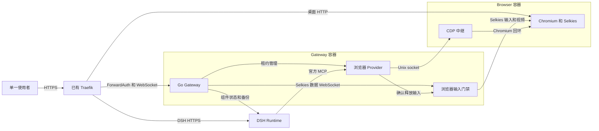

# DSH Web Workstation 架构

[English](ARCHITECTURE.md) · 简体中文

## 产品边界

DSH Workstation 是围绕官方 DSH 应用的自托管部署、安全、浏览器控制和运维增强层。DSH 继续负责 Agent Runtime、聊天/会话界面、终端、Profile 和 Plugin Manager。本项目不另造 Agent Runtime、编辑器、包管理器或公共插件市场。

首版严格单用户：一个本地管理员、一份 DSH_HOME、一个工作区、一份 Chromium 配置。该管理员可以注册多个 Passkey。不得让第二个账户共享这些资源。多用户必须另行设计租户隔离，不属于首版范围。

## 组件边界

| 组件 | 职责 |
| --- | --- |
| Runtime 镜像 | 提供 Node.js、固定版本 pnpm、Git/SSH、CA 证书和常用原生构建工具。DSH npm 安装保存在持久化存储，由专用 CLI/API 管理。 |
| Runtime 管理器 | 写操作持锁。每个确切版本独立安装，验证后原子切换指针，检查启动，失败则回滚。数据迁移必须有匹配的备份/恢复路径。 |
| DSH Profile | 由官方 CLI 和 Plugin Manager 管理。沿用固定版本目录结构，将 DSH_HOME 放在同一文件系统，让 pnpm 链接可访问 Store。 |
| Go Gateway | 提供认证、浏览器控制和运维入口。管理员的数据存入 SQLite WAL，通过 Runtime 执行备份和校验。Gateway 容器也运行 Provider 和输入门禁。 |
| 浏览器 Provider | 接收官方 MCP 调用，每次操作验证与会话绑定的租约和代次，通过 CDP 连接 Chromium。只开放明确批准的工具。 |
| Chromium 和 Selkies | 使用一个 Chromium 进程和一份持久化配置。人工通过 Selkies 操作，Provider 自动化控制同一个浏览器。 |
| 浏览器输入门禁 | 代理 Selkies 数据 WebSocket，并在 Provider 变更控制权前确认释放已按住的输入。 |
| Traefik | 路由公网 HTTPS 请求，由 Go Gateway 验证 DSH 和 Selkies 的访问。 |
| 原生 Sidebar | 延后增强。首版正式入口是已认证的独立浏览器/控制页面。 |

## 公网 Compose 网络

精简版常驻 `gateway` 和 `runtime`，完整版增加 `browser`。两种形态都复用工作台 Compose 项目之外的 Traefik。[服务清单](../deploy/public/README.zh-CN.md#选择部署形态) · [ADR-0007](adr/0007-three-service-deployment.zh-CN.md)

| 网络 | 端点 |
| --- | --- |
| 已有代理网 | Traefik 与 Gateway。Gateway 的公开和校验监听器绑定在这张网，并验证可信 Traefik 对端。 |
| `workstation` | Runtime、Gateway 和 Browser。Traefik 也接入这张网，访问 DSH 和 Selkies HTTP。 |

Browser 内的 Nginx 校验 Selkies 数据 WebSocket 和令牌管理请求的 Gateway 来源地址。Gateway 校验操作者会话后，将数据 WebSocket 交给输入门禁。Provider 管理端口和输入门禁只监听 Gateway 回环。Chromium 的 CDP TCP 只监听 Browser 回环，Browser 写入私有 Unix socket，Gateway 只读挂载。[拓扑和 CI](roadmap/public-compose.zh-CN.md)

`deploy/network.sh` 从 `WORKSTATION_SUBNET` 推导 Runtime 和 MCP 的 `.2`、`.3` 地址、Runtime 证书 SAN 和子网上半段的动态地址池。Browser 使用动态地址。

`deploy/network.sh check` 在初始化前运行，遇到与宿主机路由或现有 Docker 网络重叠时拒绝执行。检查比较具体路由，因为 Docker 的子网路由优先于默认路由。改变已保存的 `WORKSTATION_SUBNET` 时，需要用 `--reissue` 替换 Runtime 证书和内部 CA。

## 路由

| 路径 | 上游和访问方式 |
| --- | --- |
| `/` | DSH，由 ForwardAuth 保护。 |
| `/browser/` | Selkies，使用同一 ForwardAuth，由 Traefik 保留前缀。 |
| `/_auth/` | 登录和账户界面及 API。这些路由不经过自己的 ForwardAuth。 |
| `/mgmt` | 经过会话认证的 Gateway 控制台，提供 Runtime 状态、备份与校验、浏览器控制和账户设置。 |
| 内部校验端点 | Go Gateway，只信任配置的 Traefik 对端。 |
| Provider 管理 | 仅限 Gateway 回环，通过内部管理员凭据校验。 |

按确切上游版本验证子路径、响应头、CSP、WebSocket 和登录行为。

## 数据归属和持久化

| 存储 | 内容 |
| --- | --- |
| DSH_HOME | Runtime 版本、Profile 清单和锁文件、node_modules、pnpm Store、会话、设置、凭据、插件配置及用户和共享 Skills。使用同一个持久化卷。 |
| 工作区 | Web 默认工作区、项目文件和项目 Skills，使用独立卷或绑定挂载。 |
| Chromium `/config` | 持久化浏览器配置、Cookie、扩展和下载。 |
| Gateway SQLite（`auth-data`） | 唯一管理员和会话状态存入独立 SQLite 卷。 |
| Provider 状态 | Provider 重启时用于失败关闭的租约/恢复状态。 |
| 认证密钥 | Docker secrets 或只读文件。与数据库分开存储和备份。 |
| 部署配置 | 保存在 Git，密钥留在仓库外。 |

Runtime 镜像将 Linux 的 Documents 指向 `/workspace`。DSH 首次使用时创建 `/workspace/deepseek-harness/default-workspace`，之后沿用已有注册。Skills 可放在 `$DSH_HOME/skills`、`$DSH_AGENTS_HOME/skills`（位于 `$DSH_HOME/.agents`，也可通过 `~/.agents` 访问）或项目的 `.agents/skills` 目录。

## 认证和账户模型

1. 初始化只创建一个本地管理员。成功后永久关闭账户创建。
2. 密码登录使用独立 TOTP 挑战。Passkey 是独立登录方式；同一管理员可以注册多个 Passkey。
3. 不包含用户创建、邀请、角色体系、租户选择或共享账户模式。
4. 会话 Cookie 为 `__Host-dsh_session`，使用 `Secure`、`HttpOnly`、`SameSite=Lax`、`Path=/`，省略 `Domain`。

## 浏览器控制和安全

- 控制状态包括 HUMAN、AGENT、HANDOVER、PAUSED 和 DISCONNECTED。
- 租约记录租约 ID、持有者类型和 ID、DSH 会话 ID、代次、发放及过期时间。采用事务式比较并交换。
- 每次工具调用都经过统一的服务端准入点，检查已认证 MCP peer、在线 DSH 会话绑定、租约持有者、代次、过期时间、来源策略和执行中操作状态。
- Agent 控制时，在 Selkies 输入边界拦截人工键盘和鼠标。接管必须排空或安全取消当前操作、释放已按住输入并确认，然后才能切换所有者。
- 过期、无法确认渲染器是否结束、Provider 重启或浏览器进程退出时必须失败关闭。实际输入路径通过测试后才能宣称独占。
- 通过 CDP 连接 Chromium 默认上下文，共享标签页和 Cookie。禁止工具关闭浏览器或上下文。
- `BROWSER_TOOL_ORIGINS` 是 Provider 应用层来源白名单，不是网络出口防火墙或完整 SSRF 防护。Chromium 仍会执行页面脚本和跟随重定向。
- 在开放 Agent 广泛访问不可信网站前，增加独立浏览器出口控制，在 DNS 解析后及重定向时阻止回环、链路本地、私有网段、云元数据和其他禁止目标。CDP 与 Provider 管理端保持私有。

## Runtime 升级与恢复

- 候选 DSH 版本并行安装，绝不就地修改活动安装。
- 修改 Profile 或插件依赖前，备份 DSH_HOME 并记录确切 Runtime、DSH、Profile 和插件版本。
- 验证候选版本启动、Node 兼容性、Profile/Bundle 兼容性、锁文件一致性和明确批准的生命周期脚本。
- `dsh-runtime upgrade` 是一个事务：在活动版本旁安装、门禁、在副本上就绪检查、记录指纹、归档加清单，最后才移动指针。被阻断的候选版本保持安装状态，指针不动。
- Runtime 监督进程在共享 DSH_HOME 中持有服务锁。独立的维护容器必须获取这把锁，才能升级、切换、回滚或恢复。从 Web 发起升级时，监督进程先停止 DSH Web，再把锁描述符传给 CLI 子进程。备份使用独立的共享状态锁，可以在 DSH Web 运行时执行。
- `/mgmt/upgrade` 校验确切的 DSH 版本和近期 TOTP，再由 Gateway 将请求发往 Runtime 私有维护监听器。CLI 和监督进程将阶段原子写入 `$DSH_HOME/runtime/upgrade-status.json`，供 Gateway 展示。监督进程在切换后启动 DSH Web，通过就绪检查后校验 Profile。切换后启动失败会恢复匹配的状态备份。独立 CLI 操作也通过同一个数据卷显示进度。
- 批准针对精确的 `package@version` 并保存在 DSH_HOME 中，因此对后续回滚同样生效。DSH 自身依赖树中的生命周期脚本只报告不阻断，因为该策略固定为 `--ignore-scripts` 且对所有版本一致。
- 指针回滚只恢复所选可执行版本。如果发生数据迁移，还必须恢复匹配的 DSH_HOME 备份及相关工作区状态。`verify` 比较 Profile 清单、锁文件和 pnpm 存储中的包版本与切换前指纹，并给出所需操作。
- DSH_HOME 备份排除 `runtime` 和 `pnpm`，因为两者都可重新安装；改用清单记录选择状态和 Runtime 镜像，并拒绝校验和、所有者或 DSH 版本不匹配的恢复。
- 备份覆盖 DSH_HOME、工作区、Chromium 配置、Gateway SQLite 数据库、Provider 状态和加密密钥。恢复测试必须证明管理员仍可使用 TOTP 和现有 Passkey。

## 发布和部署

- Runtime、DSH npm、Gateway、Workstation 插件（正式发布时）和 Chromium 分别版本化。
- CI 必须覆盖实际部署 Traefik 版本范围，包括目标补丁版本；较新 CI 版本通过不能证明较旧部署版本兼容。
- Runtime 和 Gateway 按不可变版本标签及摘要发布到 GHCR。Provider 与输入门禁随 Gateway 发布。保留可复现构建证据和校验和。
- 首版只支持 Linux amd64。镜像和全栈测试覆盖前不得宣称支持 ARM64。
- DSH 和 Gateway 不挂载 Docker socket。采用最小权限、可行时只读文件系统、非 root 用户、健康检查和明确的密钥管理。

## 延后工作

原生 DSH Sidebar 不是首版上线门槛，必须完整支持已认证的独立浏览器/控制页面。后续只能通过 DSH 公开 API 实现 Sidebar，不得 Fork DSH 核心或依赖私有 DOM。

多用户租户、Kubernetes、Windows Companion、自研 Agent Runtime/编辑器、公共插件市场和多个并行浏览器实例均不在首版范围。
