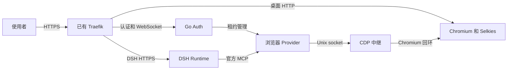

# DSH Web Workstation 架构

[English](ARCHITECTURE.md) · 简体中文

## 组件边界

| 组件 | 职责 |
| --- | --- |
| Runtime 镜像 | 提供 Node.js、固定版本 pnpm、Git/SSH、CA 证书和常用原生构建工具。DSH npm 安装保存在持久化存储，由专用 CLI 或 API 管理。 |
| Runtime 管理器 | 写操作持锁。每个确切版本独立安装，验证后原子切换指针，检查启动，失败则回滚。活动安装保持完整。 |
| DSH Profile | 由官方 CLI 和 Plugin Manager 管理。沿用固定版本目录结构，将 DSH_HOME 放在同一文件系统，让 pnpm 链接可访问 Store。 |
| Go Auth | 处理密码、TOTP、WebAuthn、恢复码、会话、CSRF、审计、限流、ForwardAuth 和浏览器租约协调。状态存入 SQLite WAL。Agent 由 Runtime 执行。 |
| Workstation 插件 | 原生右侧栏是产品目标。使用公开客户端 API 嵌入同源 `/browser/`，并调用认证或浏览器控制接口。依赖未公开内部实现须有 ADR 依据，保留官方 DSH 核心。 |
| 浏览器 Provider | 接收官方 MCP 调用，验证租约，通过 CDP 连接 Chromium。 |
| Chromium 和 Selkies | 使用一个 Chromium 进程和一份持久化配置。人工通过 Selkies 操作，Provider 自动化控制同一个浏览器。 |
| Traefik | 路由公网 HTTPS 请求，由 Go Auth 验证 DSH 和 Selkies 的访问。 |

## 公网 Compose 网络

| 网络 | 端点 |
| --- | --- |
| 已有代理网 | Traefik 与 Auth。Auth 的公开和校验监听器绑定在这张网。 |
| `workstation` | Runtime、MCP 监听器，以及 Traefik 和 Auth 连接 DSH 的路径。 |
| `browser` | Chromium、Provider 管理监听器，以及 Traefik 和 Auth 连接 Selkies 的路径。 |

中继与 Chromium 共用网络命名空间。仅中继和 Provider 挂载 CDP socket 卷。Auth 转发 DSH 和 Selkies 的 WebSocket，并检查会话是否有效。[已验证拓扑](roadmap/public-compose.zh-CN.md)

## 路由

| 路径 | 上游和访问方式 |
| --- | --- |
| `/` | DSH，由 ForwardAuth 保护。 |
| `/browser/` | Selkies，使用同一 ForwardAuth，由 Traefik 保留前缀。 |
| `/_auth/` | 登录和账户界面及 API。这些路由不经过自己的 ForwardAuth。 |
| 内部校验端点 | Go Auth，信任 Traefik 对端。 |

按确切上游版本验证子路径、响应头、CSP、WebSocket 和登录行为。

## 数据归属和持久化

| 存储 | 内容 |
| --- | --- |
| DSH_HOME | Runtime 版本、Profile 清单和锁文件、node_modules、pnpm Store、会话、设置、凭据和插件配置。使用同一个持久化卷。 |
| 工作区 | 项目文件，使用独立卷或绑定挂载。 |
| Chromium `/config` | 持久化浏览器配置、Cookie、扩展和下载。 |
| Auth 数据 | SQLite 数据库存放在独立卷。 |
| Auth 密钥 | Docker secrets 或只读文件。与数据库分开存储和备份。 |
| 部署配置 | 保存在 Git，密钥留在仓库外。 |

## 认证流程

1. **密码登录**时，Auth 验证用户名和密码，发放短期、一次性挑战。用户在独立界面输入 TOTP，每个时间步只验证一次，成功后换发不透明会话 Cookie。
2. **Passkey 登录**时，Auth 发放一次性 WebAuthn 挑战，要求用户验证，严格检查 RP ID 和 HTTPS 源。断言正确后建立会话。账号仍需绑定 TOTP。

会话 Cookie 为 `__Host-dsh_session`，使用 `Secure`、`HttpOnly`、`SameSite=Lax`、`Path=/`，省略 `Domain`。

## 浏览器控制

- **控制状态**包括 HUMAN、AGENT、HANDOVER、PAUSED 和 DISCONNECTED。
- **租约**记录租约 ID、持有者类型和 ID、DSH 会话 ID、代次、发放及过期时间。采用事务式比较并交换。
- **每次工具调用都要校验租约。**Agent 控制时，在 Selkies 输入边界拦截人工键盘和鼠标。过期或进程退出时回到 HUMAN 或 DISCONNECTED。
- **通过 CDP 连接** Chromium 的默认上下文，共享标签页和 Cookie。核对 Playwright 的 CDP 限制，避免工具关闭浏览器或上下文。
- 如果上游不能可靠拦截输入，评估可维护的认证输入网关、代理或集成镜像。实际输入路径通过测试后才能宣称独占。[待补场景](https://github.com/sagehou/dsh-workstation/issues/1)

## 版本管理

Runtime 镜像、DSH npm 包、Auth 镜像、Workstation 插件和 Chromium 镜像分别版本化。更新 Runtime 镜像保留所选 DSH 版本。更新 DSH 保留 Runtime 镜像。Profile 和插件数据可能迁移，升级前须备份并检查迁移。

## 安全边界

- CDP 和浏览器管理接口保留在私网。工作台不挂载 Docker socket。
- 入口删除或替换客户端身份请求头。ForwardAuth 信任配置的代理对端。
- 登录和校验端点不经过自己的 ForwardAuth。拒绝未认证 API 和 WebSocket 时不返回登录页面。
- 初期只允许可信用户访问。浏览器终端拥有其容器的操作权限，账号认证本身不提供租户隔离。
